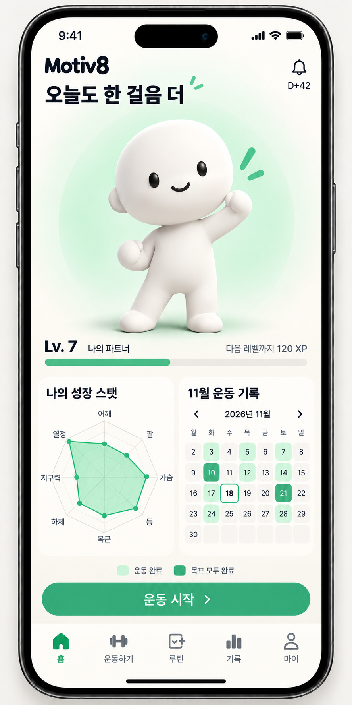
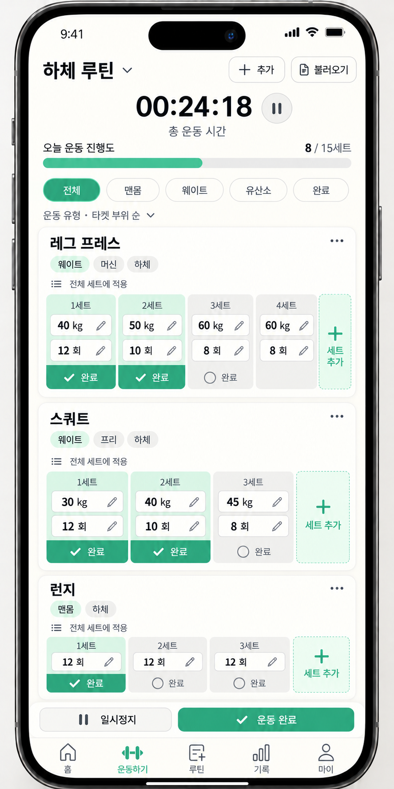

# Motiv8 Frontend

운동 기록으로 캐릭터를 성장시키는 Motiv8의 프론트엔드 프로젝트다. 현재 웹 화면을 설계하며, 이후 앱 전환을 고려해 모바일 중심으로 구성한다.

## 화면 목업

현재 화면 구성과 분위기를 검토하기 위한 시안이다. 이미지 속 날짜·수치·운동 기록은 예시이며, 실제 구현 데이터나 API 계약을 나타내지 않는다.

### 홈

- 캐릭터를 화면의 중심에 크게 배치하고 레벨·경험치를 함께 보여준다.
- 알림 아이콘 아래 `D+N`은 **첫 운동 기록일**부터 센다.
- 아래 두 카드는 같은 크기로 나눈다. 왼쪽은 8각형 성장 스탯, 오른쪽은 간략한 월별 운동 기록 달력이다.
- 스탯 축은 `어깨 · 팔 · 가슴 · 등 · 복근 · 하체 · 지구력 · 열정`이다. 값과 열정 산정은 백엔드 결과를 사용한다.
- 달력은 날짜와 운동·목표 완료 상태를 색으로 구분한다. 날짜 선택 시 상세 기록으로 이동한다.
- 하단의 `운동 시작`으로 운동 화면에 진입한다.

### 운동하기

- 루틴 이름, 운동 추가·불러오기, 경과 시간과 전체 세트 진행률을 위에 둔다.
- 필터는 `전체 · 맨몸 · 웨이트 · 유산소 · 완료`. 모든 세트를 마친 운동은 `전체`에서 빠지고 `완료`에서 확인한다.
- 운동 카드는 세트별 중량·반복 횟수와 별도의 완료 동작을 보여준다. 맨몸은 추가 중량을 선택한 경우에만 입력한다.
- 카드의 마지막 세트 옆 `+ 세트 추가`를 누르면 직전 세트의 값으로 새 미완료 세트를 만든다. 새 세트는 수정할 수 있다.
- 일시정지·운동 완료는 하단 탐색 바로 위에 둔다.

## 문서

- [화면·시각 기준](.codex/design/ui-direction.md)
- [운동 수행 요구사항](.codex/domain/workout-session.md)
- [프론트엔드 개발 기준](.codex/README.md)
